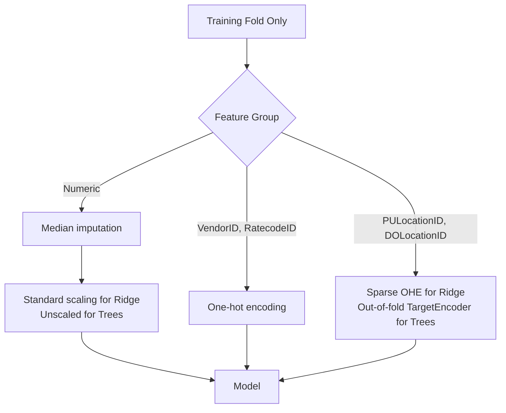

# NYC Taxi Trip Duration Predictor (Group 10)

> **A reproducible Python machine-learning project that predicts NYC Yellow Taxi trip duration in minutes using only information available when a trip begins.**


## Project in one sentence

This project investigates how pickup time, pickup/dropoff zones, and pre-trip characteristics relate to NYC Yellow Taxi trip duration, and builds a leak-free predictive model for `trip_duration_min` using only information available at trip start.

## Why this project matters

NYC TLC trip records include end-of-trip fields such as `tpep_dropoff_datetime`, `fare_amount`, `tip_amount`, `tolls_amount`, `total_amount`, `payment_type`, and surcharges. Using those columns would leak the answer because metered fares and dropoff timestamps depend directly on elapsed travel time. This project drops every post-trip column before modeling so predictions rely strictly on trip-start information and support real-world travel-time estimation.

## Project flow

```mermaid
flowchart LR
    A[yellow_tripdata_2024-07.xlsx<br/>3 sheets, 3.08M rows] --> B[Stream XML & compute<br/>trip_duration_min]
    B --> C[Clean anomalies &<br/>remove duplicates]
    C --> D[Drop 12 post-trip<br/>leakage columns]
    D --> E[Save full cleaned CSV<br/>& compute full EDA]
    E --> F[120k uniform sample<br/>80/20 train-test split]
    F --> G[Leak-free pipelines<br/>Scaler / OHE / TargetEncoder]
    G --> H[Compare 4 baselines<br/>5-fold KFold CV]
    H --> I[GridSearchCV tuning &<br/>VotingRegressor ensemble]
    I --> J[Segment reliability<br/>analysis & report.md]
```



## Dataset

| Item | Value |
|---|---|
| Source | NYC TLC Yellow Taxi Trip Record Data (July 2024) |
| Source file | `yellow_tripdata_2024-07.xlsx` (`Data_1`, `Data_2`, `Data_3`) |
| Raw rows | 3,076,903 |
| Cleaned rows | 2,972,241 (96.60% retained) |
| Target | `trip_duration_min` in `[1.0, 180.0]` minutes |
| Removed leakage columns | `tpep_dropoff_datetime`, `fare_amount`, `extra`, `mta_tax`, `tip_amount`, `tolls_amount`, `improvement_surcharge`, `total_amount`, `congestion_surcharge`, `Airport_fee`, `payment_type`, `store_and_fwd_flag` |
| Modeling sample | 120,000 uniform random rows (96,000 train / 24,000 test) |

Because `yellow_tripdata_2024-07.xlsx` contains over 3.07 million rows across three Excel worksheets (~2.23 GB uncompressed XML), `taxi_duration_project.py` streams the `.xlsx` archive directly with Python's built-in `zipfile` and `re` modules so it runs smoothly on standard 8 GB RAM laptops without needing `openpyxl` or exhausting memory.

## What is included

```text
project/
|
|-- yellow_tripdata_2024-07.xlsx          # Raw 3-sheet NYC TLC dataset (3,076,903 rows)
|-- data/
|   `-- cleaned/
|       `-- yellow_tripdata_2024-07_cleaned.csv   # Full cleaned dataset (2,972,241 rows)
|
|-- outputs/
|   |-- figures/
|   |   |-- actual_vs_predicted.png
|   |   |-- duration_by_airport_status.png
|   |   |-- duration_by_dayofweek.png
|   |   |-- duration_by_hour.png
|   |   |-- duration_by_ratecode.png
|   |   |-- duration_distribution.png
|   |   |-- duration_vs_distance.png
|   |   |-- error_by_segment.png
|   |   |-- model_comparison_rmse.png
|   |   |-- numeric_correlations.png
|   |   |-- residual_distribution.png
|   |   `-- top_pickup_zones_duration.png
|   |-- best_params.json
|   |-- cleaning_summary.json
|   |-- cv_model_comparison.csv
|   |-- data_validation.json
|   |-- eda_summary.json
|   |-- error_analysis_by_segment.csv
|   |-- feature_importance.csv
|   |-- final_model.joblib
|   |-- model_metrics.csv
|   |-- report.md
|   `-- test_predictions.csv
|
|-- requirements.txt
|-- taxi_duration_project.py
|-- report.md                             # Root copy of outputs/report.md
`-- README.md
```

## How to run it

### Linux / macOS (virtual environment)

From inside the `project/` folder:

```bash
python3 -m venv .venv
source .venv/bin/activate
python -m pip install -r requirements.txt
python taxi_duration_project.py
```

### Windows (PowerShell)

```powershell
python -m venv .venv
.\.venv\Scripts\Activate.ps1
python -m pip install -r requirements.txt
python taxi_duration_project.py
```

### Fast re-run after cleaning

Once `data/cleaned/yellow_tripdata_2024-07_cleaned.csv` has been generated, you can skip re-streaming the 248 MB `.xlsx` file when re-running modeling and reporting:

```bash
python taxi_duration_project.py --reuse-cleaned
```

Optional flags:
- `--input PATH`: path to raw `.xlsx` file (default: `yellow_tripdata_2024-07.xlsx`)
- `--cleaned-output PATH`: path for cleaned CSV (default: `data/cleaned/yellow_tripdata_2024-07_cleaned.csv`)
- `--output PATH`: directory for metrics, figures, model, and report (default: `outputs`)
- `--sample-size N`: uniform sample size for CV/modeling (default: `120000`)

## Data preparation and features

The cleaning pipeline filters out:
- 47 records outside July 2024
- 43,590 trips outside `[1, 180]` minutes
- 19,616 trips outside `(0, 80]` miles
- 3,571 trips with implausible implied speeds outside `[1, 80]` mph
- 37,838 exact duplicate rows

Safe trip-start features engineered for modeling:

| Feature | Meaning |
|---|---|
| `pickup_hour`, `pickup_dayofweek`, `pickup_day` | Calendar and time-of-day components from `tpep_pickup_datetime` |
| `pickup_hour_sin`, `pickup_hour_cos`, `pickup_dow_sin`, `pickup_dow_cos` | Cyclical encodings preserving midnight and week wrap-around |
| `is_weekend`, `is_rush_hour`, `is_overnight` | Binary indicators for weekend, weekday rush (`07-09`, `16-19`), and night (`22-05`) |
| `trip_distance`, `log1p_distance` | Route distance proxy and log-transformed distance |
| `passenger_count`, `passenger_missing` | Driver-entered passenger count (median-imputed) plus missing/zero indicator |
| `same_zone` | `1` when `PULocationID == DOLocationID` |
| `is_airport_pickup`, `is_airport_dropoff`, `is_airport_trip` | Indicators for JFK (`132`), LaGuardia (`138`), and Newark (`1`) zones |

## Preprocessing



All imputers, scalers, one-hot encoders, and target encoders are wrapped inside `scikit-learn` `Pipeline` / `ColumnTransformer` objects and fitted on training folds only to prevent test leakage.

## Models compared

| Model | Purpose |
|---|---|
| Ridge baseline | Regularized linear baseline with sparse one-hot zones |
| Random forest baseline | Non-linear bagging ensemble |
| Extra trees baseline | Randomized tree ensemble comparison |
| HistGradientBoosting baseline | Fast histogram gradient boosting baseline |
| Tuned HistGradientBoosting | Best `GridSearchCV` 5-fold CV configuration (`max_iter=250`, `max_leaf_nodes=63`, `learning_rate=0.1`, `min_samples_leaf=50`) |
| Ensemble model | `VotingRegressor` averaging Tuned `HistGradientBoosting` and a regularized `RandomForestRegressor` |
| OD-only ablation | Sensitivity check without `trip_distance` or `RatecodeID` |

## Key results (untouched 24,000-trip test split)

| Model | MAE (min) | RMSE (min) | R-squared |
|---|---:|---:|---:|
| Ridge baseline | 4.101 | 6.346 | 0.780 |
| Extra trees baseline | 3.782 | 5.946 | 0.807 |
| Random forest baseline | 3.667 | 5.835 | 0.814 |
| HistGradientBoosting baseline | 3.561 | 5.645 | 0.826 |
| **Tuned HistGradientBoosting** | **3.470** | **5.550** | **0.832** |
| **Ensemble model** | **3.483** | **5.575** | **0.830** |
| OD-only ablation (no distance) | 5.864 | 8.481 | 0.607 |

## Main patterns and reliability gaps

- **Average trip characteristics (all 2,972,241 cleaned trips)**: Mean duration is **16.68 min** (SD 13.31 min), mean distance is **3.60 miles**. Airport trips average **37.51 min** vs. **14.03 min** for non-airport trips; hourly mean duration peaks at **16:00** (**19.08 min**) and reaches a minimum at **03:00** (**12.66 min**).
- **Where predictions are less reliable**:
  - **Very long (`>10 mi`) & airport trips**: Test MAE rises to **7.38 min** (90th-percentile error **15.20 min**) for `>10 mi` trips and **6.00 min** for airport trips, vs. **1.87 min** for `<1 mi` trips.
  - **Midday & rush hours (`07:00–19:59`)**: Higher congestion variability produces MAE of **3.61–3.78 min**, compared with **2.69 min** late at night (`00:00–06:59`).
  - **Same-zone trips (`PULocationID == DOLocationID`)**: Short local hops and multi-stop rides within one zone cannot be separated at the Taxi Zone level alone.

## Limitations

- `trip_distance` in TLC data is final odometer distance; in live pre-trip deployment, mapped route distance is used and can differ slightly during detours.
- No live weather, incident, or special-event (e.g., July 4th) signals are present in the dataset.
- Pickup/dropoff locations are Taxi Zones (`1..265`) rather than exact GPS coordinates.
- Data is from a single summer month (July 2024), so winter or holiday patterns require retraining.

## Assignment checklist

- [x] Read NYC TLC dataset description and variable definitions
- [x] Data preprocessing and anomaly filtering across all 3 sheets
- [x] Strict removal of post-trip leakage columns
- [x] Exploratory data analysis across all 2,972,241 cleaned trips
- [x] Predictive model building and evaluation (4 baselines + ablation)
- [x] Hyperparameter tuning via 5-fold `KFold` `GridSearchCV`
- [x] Segment-level reliability / error analysis
- [x] Cleaned dataset saved (`data/cleaned/yellow_tripdata_2024-07_cleaned.csv`)
- [x] Report generated (`outputs/report.md` and `report.md`)
- [ ] Replace placeholder group-member names and contributions in `report.md` / `outputs/report.md`

## 21-day plan

| Days | Work |
|---:|---|
| 1-2 | Review NYC TLC data dictionary and separate trip-start vs. post-trip variables |
| 3-5 | Build streaming XML cleaner, validate bounds, and export cleaned CSV |
| 6-9 | Compute full-dataset EDA summaries and generate exploratory plots |
| 10-13 | Build linear, tree, and boosting baselines with leak-free pipelines |
| 14-16 | Tune hyperparameters with 5-fold `GridSearchCV` and build ensemble |
| 17-18 | Run OD-only ablation, permutation importance, and segment reliability analysis |
| 19-20 | Finalize `report.md`, `README.md`, and team member contributions |
| 21 | Re-run end-to-end verification and submit |
